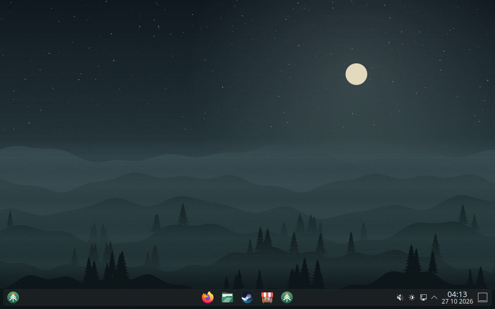
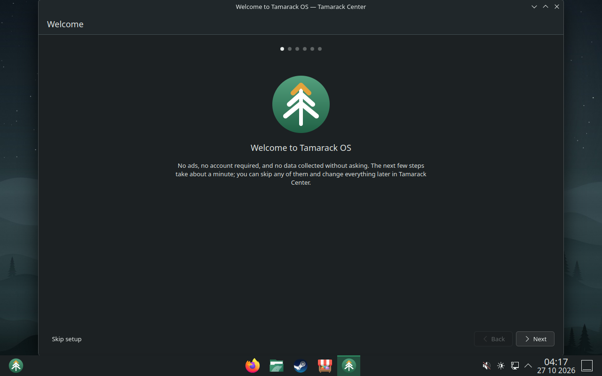
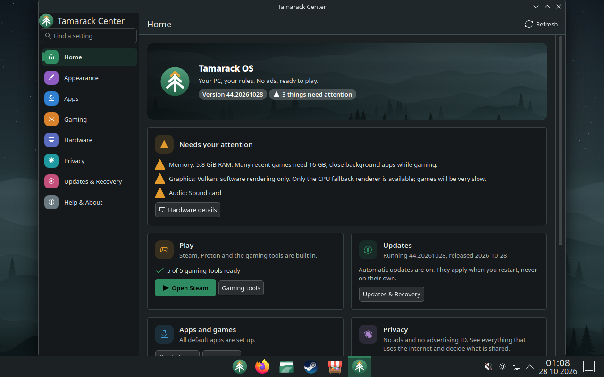
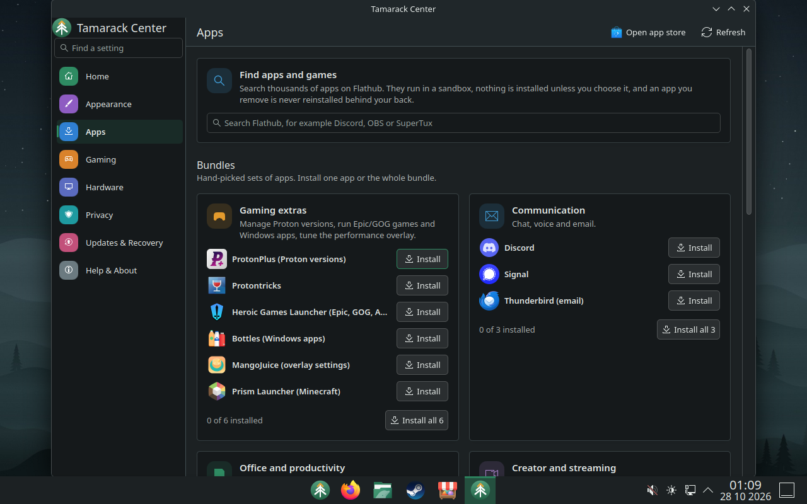
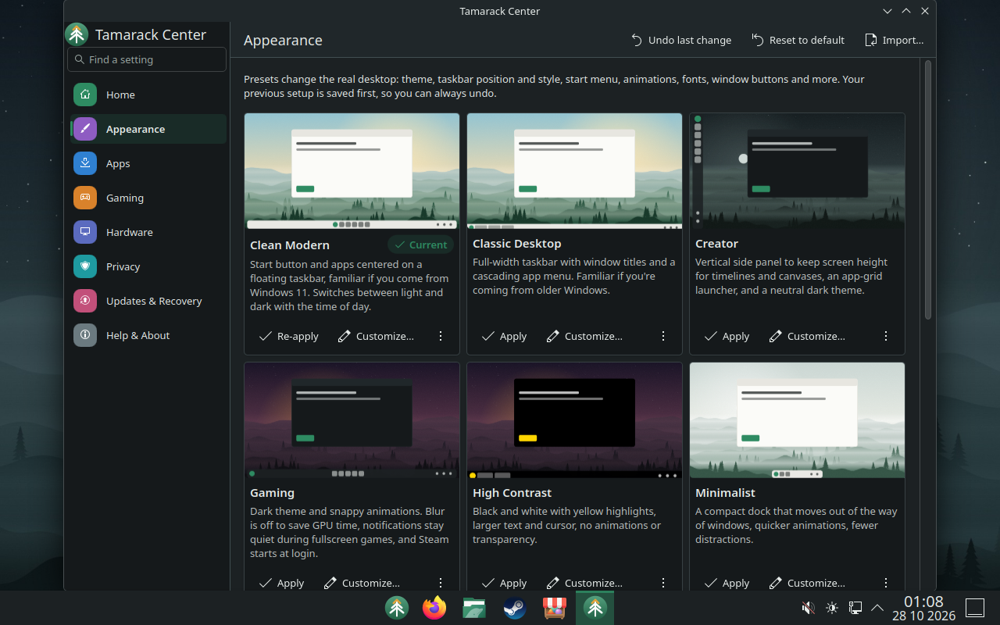
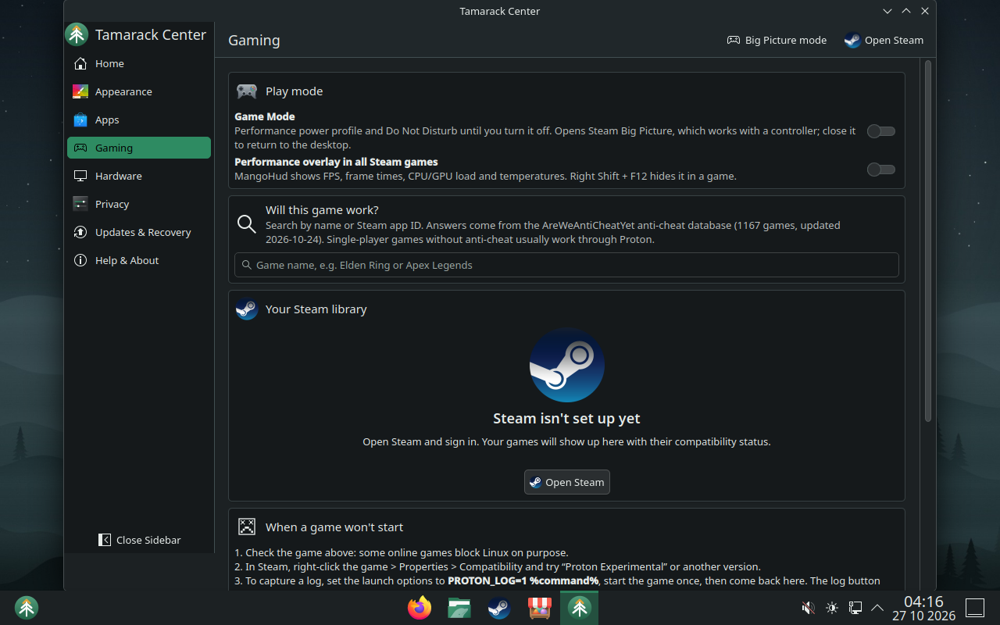
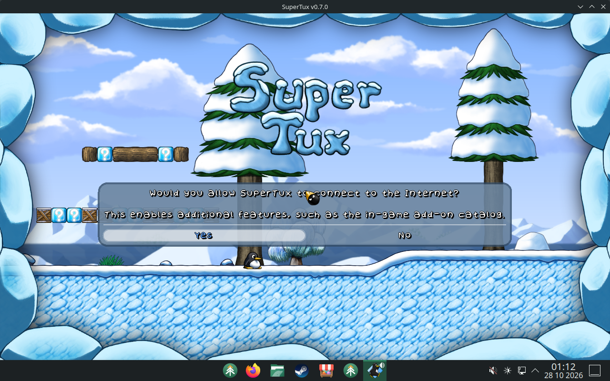
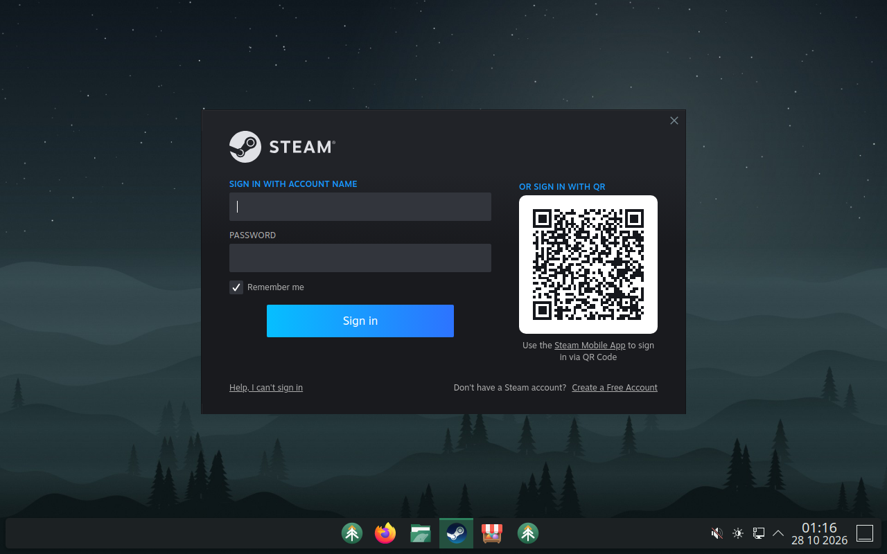

# Tamarack OS

**Your PC, your rules. No ads, ready to play.**

Tamarack OS is a desktop operating system for gaming PCs and everyday computing. It gives you a
polished KDE Plasma desktop that feels familiar if you come from Windows, real PC gaming through
Steam and Proton, and a system that stays out of your way: no ads, no account required, no data
collected without asking, and updates you can always roll back.

Under the hood it is a custom image built on [Bazzite](https://bazzite.gg/) and
[Universal Blue](https://universal-blue.org/) (Fedora Linux, KDE Plasma 6), so the kernel, graphics
drivers, Steam integration and security updates come from mature, actively maintained projects.
Tamarack adds its own identity, defaults, privacy settings and tools on top.

> **Project status: early development.** Both editions build, pass about 80 automated image checks, install from their
> ISO onto a blank disk, and boot to a working Plasma desktop in CI virtual machines. There, 126 checks cover presets,
> every Tamarack Center page, the Windows-style shortcuts, downloading and opening apps and a game from Flathub, Steam's
> first-run download, and an update to the next build with rollback. A separate check clicks all 232 controls in
> Tamarack Center. Tamarack OS has **not yet been validated on physical hardware** (no real GPU, game performance, Wi-Fi
> or audio tested). Read
> [TESTING.md](TESTING.md) for exactly what has and has not been tested before installing it on a PC
> you depend on. Tamarack OS is an independent project, not affiliated with or endorsed by Bazzite,
> Universal Blue, Fedora, KDE, Valve or Microsoft.

## Screenshots

Captured automatically by the CI virtual-machine test (QEMU, 1280×800, no GPU acceleration, at night so the theme is
dark), not mock-ups.

| | |
|---|---|
|  |  |
| Start menu, with the Start button and apps centered on the taskbar | First-run Welcome |
|  |  |
| Tamarack Center: health summary, sidebar with "Find a setting" | Apps: search Flathub, bundles, one-click install |
|  |  |
| Appearance presets | Gaming: Game Mode, overlay, anti-cheat checker |
|  |  |
| SuperTux, downloaded from Flathub and started by the VM test | Steam after downloading its client on first start |

## What you get

- **No advertising anywhere.** No sponsored apps, promoted search results, news feeds or upsell prompts
  in the OS. Firefox ships with sponsored shortcuts, sponsored stories and telemetry turned off by
  default (you can turn them back on).
- **Gaming built in.** Steam, Proton, Gamescope, MangoHud and Lutris come with the system (from Bazzite).
  The Gaming page in Tamarack Center checks whether a game's anti-cheat works on Linux before you buy it
  (sourced data, never guesses), lists your Steam library with compatibility ratings, shows Proton launch
  logs, builds per-game launch options (performance overlay, frame cap, FSR upscaling, discrete GPU) and on
  hybrid laptops can run Steam on the discrete GPU. **Steam Gaming Mode**, a full-screen, controller-first
  Steam session like a Steam Deck's, is one choice away on the sign-in screen.
- **Familiar if you come from Windows.** The Start button and your apps sit centered on the taskbar, the
  Windows shortcuts work (Win to open Start, Win+E files, Win+I settings, Win+Tab task view, Win+S search,
  Win+arrows to snap, Ctrl+Shift+Esc for the task manager), and Tamarack Center has a sidebar and a
  "Find a setting" search like Windows Settings.
- **Three editions.** `tamarack-os` for AMD and Intel graphics, `tamarack-os-nvidia` for NVIDIA GTX 16-series
  and RTX cards (open kernel modules, signed for Secure Boot), and `tamarack-os-nvidia-legacy` for older NVIDIA
  cards (GTX 900/1000 series, NVIDIA's proprietary driver).
- **Presets that change the real desktop.** Clean Modern (default), Classic Desktop, Minimalist, Gaming,
  Creator, Productivity and High Contrast each set the theme, taskbar position and style, start menu,
  animations, fonts, window buttons, virtual desktops and more. Build your own with a live preview,
  export or import it, and undo any change.
- **Privacy dashboard.** See every app's camera/microphone/location/file access, what starts automatically,
  which services run and why, open network ports, and everything that connects to the internet.
  Optional data sharing (Fedora's anonymous install count) is off by default.
- **Safe updates.** Updates download in the background and apply at your next restart; the system never
  restarts on its own. The previous version is always kept, so you can roll back from Tamarack Center or
  the boot menu. Images are signed and verified.
- **A clean install.** A browser and a few viewers; everything else is your choice. Search Flathub's
  thousands of apps and games from Tamarack Center, pick from optional bundles (gaming tools, office, creator
  apps, development, backups…) or use the app store. Apps you remove are never reinstalled behind your back.
- **Hardware check.** One page shows each device, its driver and what to do if something needs attention.

## Get it

There are four ways to try Tamarack OS. Back up your data first: see [docs/INSTALL.md](docs/INSTALL.md)
for dual-boot and Secure Boot guidance.

1. **Switch from an existing Bazzite / Universal Blue / Fedora Atomic install** (keeps your files):
   ```bash
   sudo bootc switch ghcr.io/brecken321/tamarack-os-nvidia:stable
   ```
   Use `tamarack-os` instead of `tamarack-os-nvidia` for AMD/Intel graphics, then reboot. Your current
   system does not know Tamarack's signing key yet, so this first download is checked only by TLS; from
   the first Tamarack boot on, every update must carry a valid Tamarack signature.
2. **Installer ISO**: download it from the latest successful
   [Disk images and VM test](https://github.com/Brecken321/tamarack-os/actions/workflows/build-disk.yml)
   run (artifacts `tamarack-os-iso` / `tamarack-os-nvidia-iso` / `tamarack-os-nvidia-legacy-iso`), verify the `.sha256` checksum, and write it
   to a USB stick (8 GB or larger) with Fedora Media Writer, balenaEtcher or Rufus (DD mode).
3. **Live USB** (try it without installing): artifacts `tamarack-os-live-iso` / `tamarack-os-nvidia-live-iso` /
   `tamarack-os-nvidia-legacy-live-iso`
   from the same run. It starts signed in to the desktop and changes nothing on your disks; it needs Secure
   Boot turned off while you use it (see [docs/INSTALL.md](docs/INSTALL.md#optional-try-it-first-with-the-live-usb)).
4. **Virtual machine**: build a qcow2 disk with `just disk main qcow2` (Linux) and boot it in
   virt-manager/GNOME Boxes with UEFI.

## Build it yourself

Builds run in GitHub Actions on every push. Locally (Linux with podman):

```bash
just build main          # or: just build nvidia
just check-image main    # run the content checks inside the built image
just test                # unit tests (any OS with Python 3.11+)
just lint
```

See [CONTRIBUTING.md](CONTRIBUTING.md) for the repository layout and [ARCHITECTURE.md](ARCHITECTURE.md) for how
it fits together. Everything brand-related (name, colors, wallpapers, URLs) lives in
[branding/brand.toml](branding/brand.toml).

## Documentation

| Document | Contents |
|---|---|
| [docs/INSTALL.md](docs/INSTALL.md) | Installing, dual-boot, Secure Boot, switching editions |
| [TROUBLESHOOTING.md](TROUBLESHOOTING.md) | Boot, graphics, games, audio, updates, recovery |
| [TESTING.md](TESTING.md) | What is tested automatically, what was verified, hardware checklist |
| [docs/HARDWARE.md](docs/HARDWARE.md) | Supported hardware, tested devices, known limitations |
| [docs/PRIVACY.md](docs/PRIVACY.md) | Everything that uses the network and how to control it |
| [ARCHITECTURE.md](ARCHITECTURE.md) | Design decisions and how the image is built |
| [docs/PRESETS.md](docs/PRESETS.md) | Preset file format |
| [docs/RELEASING.md](docs/RELEASING.md) | Release, signing and upgrade process |
| [ROADMAP.md](ROADMAP.md) | Milestones and remaining work |
| [SECURITY.md](SECURITY.md) | Security model and how to report vulnerabilities |
| [LICENSES.md](LICENSES.md) | Licensing and attributions |

## License

Tamarack OS's own code and configuration are licensed under the [Apache License 2.0](LICENSE). The
operating system includes many other projects under their own licenses; see [LICENSES.md](LICENSES.md).
